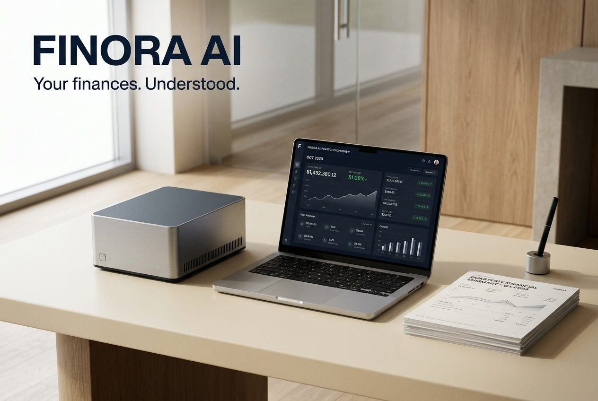
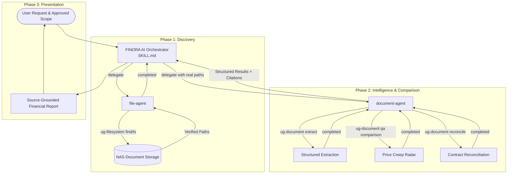

# FINORA AI — Your finances. Understood.

[](https://skills.ugreen.com)
[]()
[]()
[]()
[](LICENSE)

<p align="center">
  
</p>

> **FINORA AI** is an AI-powered financial document intelligence Skill engineered for **UGREEN AI NAS** running the Uliya AI platform. It transforms scattered, unorganized invoices, receipts, bills, and contracts into structured, source-grounded financial intelligence without compromising privacy.

---

## Table of Contents

1. [Project Overview](#1-project-overview)
2. [Problem Statement](#2-problem-statement)
3. [The FINORA AI Solution](#3-the-finora-ai-solution)
4. [Key Features](#4-key-features)
5. [Signature Feature: Price Creep Radar](#5-signature-feature-price-creep-radar)
6. [Architecture & Expert Agent Orchestration](#6-architecture--expert-agent-orchestration)
7. [Supported UGREEN Platform Capabilities](#7-supported-ugreen-platform-capabilities)
8. [Skill Packaging & Installation](#8-skill-packaging--installation)
9. [Static Validation & Quality Assurance](#9-static-validation--quality-assurance)
10. [Known Limitations & Testing Boundary](#10-known-limitations--testing-boundary)
11. [Repository Structure](#11-repository-structure)

---

## 1. Project Overview

FINORA AI is a privacy-first orchestration Skill for UGREEN AI NAS that understands, extracts, answers questions about, and compares local financial documents. 

Rather than sending sensitive bank records and utility bills to public cloud LLMs, FINORA AI runs on-device workflows across user-approved storage locations. Every financial figure, comparison, and variance is grounded directly in verified source files with page citations.

---

## 2. Problem Statement

Home NAS users, freelancers, and small business owners commonly store financial records across disparate folders on their storage arrays:
- **Financial Blind Spots**: Receipts, PDF invoices, and utility statements accumulate in arbitrary folders without centralized indexing.
- **Tedious Manual Search**: Locating a specific vendor invoice from six months ago requires digging through directory trees.
- **Silent Price Creep**: Recurring service providers, utility companies, and subscription tools raise rates incrementally over consecutive cycles, escaping notice without painstaking manual comparison.
- **Privacy Trade-offs**: Uploading sensitive financial records to third-party cloud finance platforms introduces unacceptable security and confidentiality risks.

---

## 3. The FINORA AI Solution

FINORA AI bridges physical document storage and actionable financial intelligence on UGREEN AI NAS:

1. **Scoped Document Discovery**: Scans user-designated folder scopes to find relevant invoices, receipts, and billing records without unapproved crawls.
2. **Structured Field Extraction**: Extracts merchant names, transaction dates, itemized fees, taxes, and total amounts into standardized schemas.
3. **Document Q&A**: Answers natural-language financial queries (e.g., *"What was the total VAT paid on office supplies last quarter?"*) with exact document citations.
4. **Contract-to-Invoice Reconciliation**: Compares agreed contractual rates against issued vendor invoices to identify billing variances.
5. **Price Creep Radar**: Tracks consecutive billing cycles to highlight price increases, base fee spikes, and hidden surcharge fluctuations.

---

## 4. Key Features

- **Source-Grounded Integrity**: Every financial finding links to the underlying document path and page citation. Zero fabricated totals.
- **Deterministic Schemas**: Uses catalog-defined templates (`invoice`, `receipt`, `expense`, `contract`, `purchase_order`, `mixed`) for consistent data extraction.
- **Zero File Mutation**: Purely read-only operations (`effect: read`, `approval: none`). Never alters, moves, renames, or deletes user files.
- **Strict Scope Boundaries**: Operates exclusively in user-approved directory scopes; never assumes whole-NAS access.
- **Empty & Partial Result Transparency**: Explicitly reports zero matches or partial reads without guessing missing figures or silently expanding scopes.

---

## 5. Signature Feature: Price Creep Radar

**Price Creep Radar** compares recurring billing documents across consecutive billing cycles (e.g., utility bills, broadband providers, insurance premiums, software invoices):

- **Consecutive Cycle Comparison**: Analyzes verified document paths across chronological periods.
- **Variance Breakdown**: Isolates base rate changes from variable factors like billing duration, consumption usage, and local taxes.
- **Percentage & Delta Calculation**: Computes exact monetary differences and percentage changes only when comparable structured values exist.
- **Evidence Linking**: Directly cites the exact files and page numbers backing each reported rate increase.

> *Note: Price Creep Radar analyzes existing documents stored on the NAS. It operates on demand and does not claim automatic background scheduling or external banking sync.*

---

## 6. Architecture & Expert Agent Orchestration

FINORA AI adheres to the **UGREEN Uliya Orchestration Skill Contract**. The parent Skill does not invoke low-level CLI binaries directly; instead, it coordinates registered full-profile subagents via standard delegation syntax:

```bash
delegate --target <agent-id> --instruction '<task>'
```



### Registered Subagents

| Subagent ID | Underlying CLI | Responsibilities |
|---|---|---|
| **`file-agent`** | `ug-filesystem` | Discovers financial documents (`find`, `ls`) in approved directory scopes. |
| **`document-agent`** | `ug-document` | Extracts structured fields (`extract`), inspects metadata (`metadata`), answers questions & compares bills (`qa`), and reconciles contracts (`reconcile`). |

### Result Handoff & State Handling

- **Real Result Data Passing**: Downstream extraction steps consume only verified file paths returned by upstream discovery.
- **5 Delegation States**: Full coverage of `completed`, `failed`, `cancelled`, `waiting_user` (platform interruption via `ctx.ask`), and `waiting_approval` (platform authorization).

---

## 7. Supported UGREEN Platform Capabilities

FINORA AI uses only officially supported Actions from the UGREEN Capability Catalog (version 2.2.0):

### `ug-filesystem` (via `file-agent`)
- `find`: Discovers financial documents matching approved file types and keyword filters.
- `ls`: Inspects directory listings to verify file organization.

### `ug-document` (via `document-agent`)
- `extract`: Structured extraction using schemas (`invoice`, `receipt`, `expense`, `contract`, `purchase_order`, `mixed`).
- `metadata`: Reads document metadata, page counts, and scanned status.
- `qa`: Natural-language question answering and multi-document comparison (`intent: comparison`).
- `reconcile`: Reconciles contract payment schedules against invoice totals.

---

## 8. Skill Packaging & Installation

### Package Format
The official submission package [`FINORA-AI-Pretest.zip`](submission/FINORA-AI-Pretest.zip) strictly conforms to UGREEN packaging rules:
- **Max Package Size**: 10 MB limit (Actual: 2.96 KB)
- **Max Single File Size**: 1 MB limit (Actual: 6.95 KB)
- **File Count**: Maximum 100 files (Actual: 1 file, `SKILL.md`)
- **Package Structure**: Clean `finora-ai/SKILL.md` entry point.

### Publication
Validated Skills can be published directly to UGREEN SkillHub:
- **SkillHub Portal**: [https://skills.ugreen.com/skill-hub/publish](https://skills.ugreen.com/skill-hub/publish)

---

## 9. Static Validation & Quality Assurance

The Skill was validated using the official UGREEN controlled checker script:

```bash
node scripts/check-skill.mjs "../finora-ai"
```

### Checker Output
```json
{
  "checkFormatVersion": "2.0.0",
  "status": "static-pass",
  "target": {
    "skillName": "finora-ai"
  },
  "catalog": {
    "checkedVersion": "2.2.0"
  },
  "files": [
    {
      "path": "SKILL.md",
      "sha256": "02d193d993b48c5c5e0db38cb2ed34aa1d7ce687773faf178bd41c0e57729ec2"
    }
  ],
  "summary": {
    "errors": 0,
    "warnings": 0,
    "info": 0
  },
  "diagnostics": []
}
```

- **Exit Code**: `0`
- **Checker Status**: **`static-pass`**
- **Diagnostics**: **0 Errors, 0 Warnings**

---

## 10. Known Limitations & Testing Boundary

### Honest Boundaries & Scope
- **Available Files Only**: Price Creep Radar and document comparison operate on existing documents stored on the NAS. FINORA AI does not claim automated scheduled daemons, background polling, or external bank account synchronization.
- **Catalog Constraints**: Does not claim a dedicated subscription detector or external graph database.
- **Scan Quality**: Severely degraded, illegible, or handwritten scans may produce partial extractions, which are transparently reported as partial results.
- **Runtime Testing Boundary**: Static validation confirms syntactic format, subagent delegation grammar, and catalog mapping compliance. In accordance with hackathon rules, physical on-device NAS runtime execution, live latency, and hardware OCR accuracy remain subject to finalist on-device testing.

---

## 11. Repository Structure

```text
finora-ai/
├── README.md                              # Comprehensive project documentation
├── LICENSE                                # MIT License
├── skill/
│   └── SKILL.md                           # Validated UGREEN Orchestration Skill definition
├── submission/
│   ├── FINORA-AI-Pretest.zip              # Official pre-test submission package (2.96 KB)
│   └── FINORA-AI-Project-Proposal.pdf     # Official Round 1 Project Proposal PDF (5.56 KB)
├── media/
│   ├── thumbnail.png                      # Lossless brand thumbnail (1264x848)
│   └── thumbnail.jpg                      # Optimized brand thumbnail
└── docs/
    └── architecture.md                    # In-depth technical architecture documentation
```

---

## Author & Submission Details

- **Project**: FINORA AI
- **Tagline**: *Your finances. Understood.*
- **Author**: Varshitha Gedda
- **GitHub Repository**: [https://github.com/varshithaaaagedda/finora-ai](https://github.com/varshithaaaagedda/finora-ai)
- **Competition**: UGREEN AI NAS Hackathon 2026 (Round 1)
