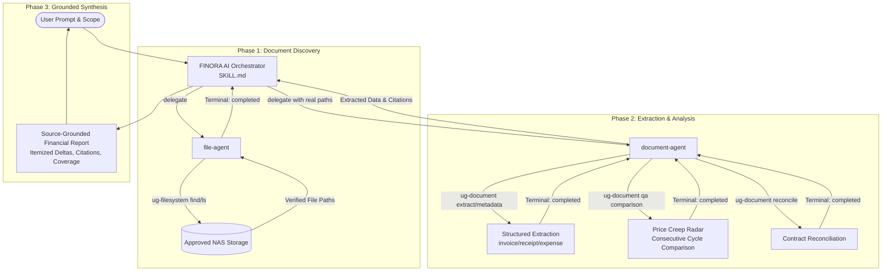

# FINORA AI — System Architecture

**Tagline**: *Your finances. Understood.*  
**Project**: Financial Document Intelligence for UGREEN AI NAS  
**Author**: Varshitha Gedda  
**Hackathon**: UGREEN AI NAS Hackathon 2026 (Round 1)

---

## 1. System Overview

FINORA AI is an orchestration Skill designed for UGREEN AI NAS running the Uliya AI platform. It provides an automated, privacy-first pipeline to discover, extract, understand, and compare financial documents—such as recurring utility bills, invoices, receipts, and expense statements—stored locally on a NAS.

FINORA AI operates strictly within user-approved directory scopes, executing read-only operations through registered expert subagents while grounding every financial finding in verifiable source documents.



---

## 2. Expert Agent Orchestration

In accordance with the UGREEN Uliya platform specification, the parent Skill does not invoke CLI tools directly via `cli.invoke`. Instead, it coordinates registered full-profile subagents using the standardized delegation contract:

```bash
delegate --target <agent-id> --instruction '<task>'
```

### Registered Agent Responsibilities

| Agent ID | Owned CLI Capabilities | Role in FINORA AI |
|---|---|---|
| **`file-agent`** | `ug-filesystem` (`find`, `ls`) | Locates target financial documents (invoices, bills, receipts) within user-specified directories without modifying, renaming, or deleting files. |
| **`document-agent`** | `ug-document` (`extract`, `metadata`, `qa`, `reconcile`) | Performs OCR and structured schema extraction, page count/metadata inspection, natural language question answering, multi-document billing comparison, and contract reconciliation. |

---

## 3. Core Workflows

### Workflow A: Document Discovery
- **Delegation Target**: `file-agent`
- **Catalog Actions**: `ug-filesystem find`, `ug-filesystem ls`
- **Task**: Discovers financial documents matching user criteria (keywords, document types, date bounds) within the user-approved folder scope.
- **Contract**: Returns verified paths, timestamps, and search metadata. Empty searches explicitly yield an empty result without auto-broadening the search perimeter.

### Workflow B: Structured Extraction
- **Delegation Target**: `document-agent`
- **Catalog Action**: `ug-document extract`
- **Supported Schemas**: `invoice`, `receipt`, `expense`, `contract`, `purchase_order`, `mixed`
- **Contract**: Parses merchant details, invoice/receipt numbers, transaction dates, itemized fees, taxes, and total amounts. Citations link directly to file paths and page numbers.

### Workflow C: Price Creep Radar (Recurring Bill Comparison)
- **Delegation Target**: `document-agent`
- **Catalog Action**: `ug-document qa` (with `intent: comparison`)
- **Task**: Compares verified documents across consecutive billing cycles (e.g., month-over-month utility bills, broadband fees, cloud subscriptions).
- **Analysis**: Calculates absolute fee variances and percentage changes while distinguishing baseline rate hikes from usage fluctuations or tax adjustments.

### Workflow D: Contract & Invoice Reconciliation
- **Delegation Target**: `document-agent`
- **Catalog Action**: `ug-document reconcile`
- **Task**: Matches agreed contractual billing terms against issued vendor invoices to detect discrepancies or unauthorized rate changes.

---

## 4. Data Handoff & State Management

FINORA AI strictly enforces verifiable data passing between workflow phases:

1. **Real Result Passing**: Downstream analysis steps consume only verified file paths and structured fields returned by upstream delegations. Hypothetical, hardcoded, or assumed paths are prohibited.
2. **Empty Result Handling**: If discovery yields zero matches (`empty result`), FINORA AI reports the outcome truthfully and terminates downstream workflows without searching unapproved directories.
3. **Partial Result Handling**: When documents contain unreadable pages or incomplete fields, results are partitioned into confirmed findings and unextracted items. Partial results are never reported as full coverage.

### Platform Lifecycle Statuses

Every delegation is evaluated against the 5 official Uliya delegation states:

- **`completed`**: Validates return data before advancing to dependent tasks.
- **`failed`**: Halts dependent workflows, preserves independently verified prior results, and reports error details.
- **`cancelled`**: Concludes processing gracefully without automated retry loops that duplicate side effects.
- **`waiting_user`**: Pauses for user clarification via platform `ctx.ask` and waits for resumption on the same delegation.
- **`waiting_approval`**: Pauses for platform security authorization and awaits formal resumption; conversational confirmation does not substitute for platform approval.

---

## 5. Security & Boundary Contract

- **Permissions**: Exclusively read-only (`effect: read`, `approval: none`).
- **File System Integrity**: No commands alter, overwrite, move, or delete documents on the NAS.
- **Catalog Conformance**: Uses only validated Actions from `ug-filesystem` and `ug-document`.
- **Runtime Testing Boundary**: Static validation confirms syntactic, orchestration, and schema adherence (`static-pass`, 0 errors, 0 warnings). Physical device execution, runtime latency, and hardware OCR performance remain subject to finalist on-NAS validation.
